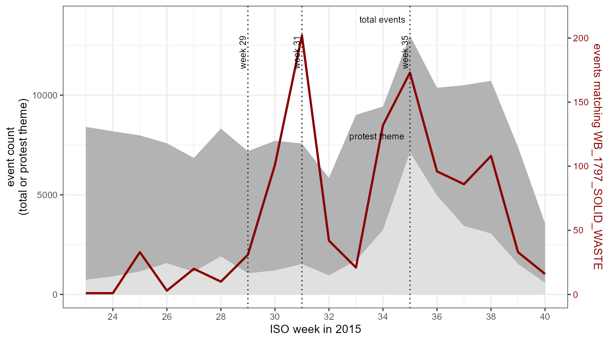
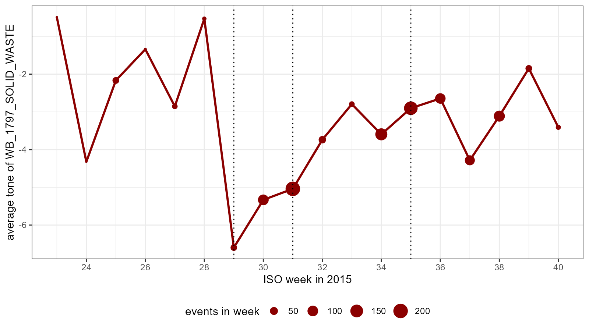
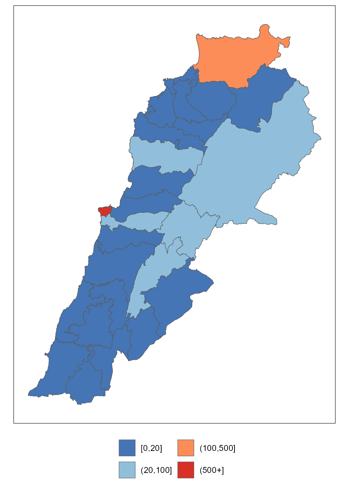
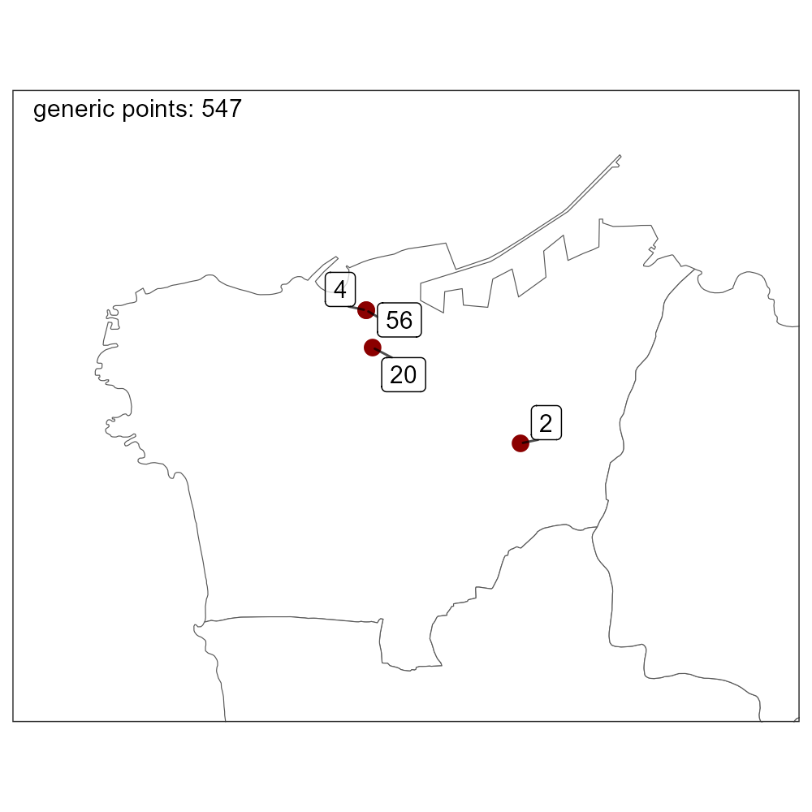
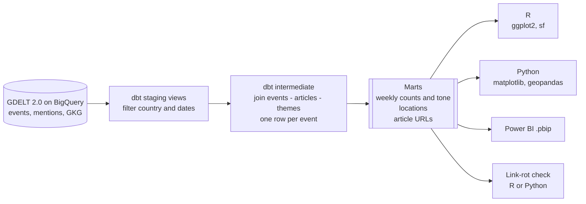

# BIDDS: GDELT media analysis, Lebanon (Garbage Crisis 2015)

**One news dataset, four toolchains, one set of numbers.** This repository reimplements the method in
Lakshman, te Lintelo, Ford, Chattat and Senanayake (2023), *Big Data for Development Studies? An Innovative
Methodology*, IDS Working Paper 596 ([DOI 10.19088/IDS.2023.053](https://doi.org/10.19088/IDS.2023.053),
CC BY 4.0) and takes it further in two ways: the pipeline is rebuilt as tested, version-controlled code, and
the same results are produced in **SQL (dbt), R, Python and Power BI** so you can compare the tools on a real
research problem.



*Grey: all events in Lebanon, June to September 2015. Red: events whose articles carry the World Bank theme
`WB_1797_SOLID_WASTE`, on a second axis. Dotted lines: the weeks the paper interprets (29, 31, 35).*

## Why you might care

| If you are... | Start here |
|---|---|
| **A development or humanitarian researcher** | [What the analysis shows](#what-the-analysis-shows) and [Fidelity to the paper](#fidelity-to-the-paper): which claims reproduce, which differ, and why |
| **A data scientist or analytics engineer** | [Architecture](#architecture), [The same results in four tools](#the-same-results-in-four-tools) and [Security and responsible sharing](#security-and-responsible-sharing) |
| **A practitioner who wants to explore without code** | [`powerbi/`](powerbi/README.md): a step-by-step guide to the interactive report |
| **Someone who just wants to run it** | [Quick start](#quick-start): the committed sample data work with **no cloud account** |

## What the analysis shows

The paper asks whether GDELT, a global database of news events, can support *case-specific* evidence for
development work, rather than only global "big picture" analysis. Each question below is answered with a
specific analytic step. All figures are for 1 June to 30 September 2015 (see
[Fidelity to the paper](#fidelity-to-the-paper) for why that is narrower than the paper).

| Research question | Analytic step | Result in this reproduction |
|---|---|---|
| **When** did media attention peak, and is a generic protest code enough to find it? | Weekly counts of events filtered by article theme (`WB_1797_SOLID_WASTE`), compared with all events and with protest-themed events | Theme-filtered events are a small share of all events (0.4% in week 29, 2.7% in week 31, 1.3% in week 35) and peak in **week 31** (202 events). Protest-themed events, all events and the CAMEO protest code all peak in **week 35**. The protest code shows little of the week-31 build-up (135 events, the same as week 28) |
| **How was it framed?** | Average GDELT tone of case-theme events per week, with marker size showing how many events each point rests on | The most negative week with at least 10 events is **week 29** (-6.6), the week the paper links to the Naameh landfill closure. Weeks 23 and 24 rest on a single event each and should not be read |
| **Where** was it happening? | Geocoded locations, joined to district boundaries | Resolution is coarse: **59%** of located events sit on the country centroid (10%) or the generic "Beirut" point (49%). District totals are led by Beirut (629) and Akkar (130) |
| **Can we verify it?** | Re-check every article URL for the three key weeks | Link rot is severe: only **29%** of 957 checked URL-week rows still resolve to a live, non-homepage page (63% in week 29, 30% in week 31, 28% in week 35) |
| **Does the choice of filter change the story?** | Compare three operational definitions of "about the garbage crisis": article theme, protest theme, keyword in URL | They disagree on the peak week (31 against 35), so the definition is a methodological choice that should be reported, not hidden |

<table>
<tr>
<td></td>
<td></td>
<td></td>
</tr>
<tr><td colspan="3"><em>Weekly tone, events by district and the Beirut inset, drawn with R (ggplot2 and sf). Python (matplotlib and geopandas) versions are in <code>docs/figures/py_*.png</code>.</em></td></tr>
</table>

**Reading the results with care.** These are descriptive counts of *media coverage*, not of events on the
ground or of public opinion. Tone is an automated score. A link that returns HTTP 200 is not guaranteed to be
the original article, and sites that block automated requests (134 responses were 403 and 37 were 429) are
counted as not live, so 29% is a lower bound. No significance tests are reported: weekly counts of this size
are noisy, the early weeks have very few events, and the aim here is description.

## Architecture



Design choices that matter:

- **Push the work to the warehouse.** The raw GDELT tables are terabytes. dbt filters to Lebanon and the date
  window inside BigQuery; about 400,000 event-article rows become three marts of 18, 34 and 2,185 rows. Only
  those marts ever leave the warehouse.
- **Marts are the contract.** R, Python and Power BI read the *same three CSV files*. Nothing is recomputed
  per tool, so differences in output point to bugs, not to different definitions.
- **Tested.** dbt tests check that event ids are unique and not null at the event grain.
- **Open by default.** `data/sample/` holds the three marts, so everything downstream runs without GCP.

## The same results in four tools

| Task | dbt / SQL | R | Python | Power BI |
|---|---|---|---|---|
| Filter and join at terabyte scale | `dbt/models/` | | | |
| Weekly counts and tone chart | `fct_weekly_counts` | `r/02_plots.R` | `python/02_plots.py` | page 1 |
| Spatial join and district map | | `sf::st_join` | `geopandas.sjoin` | scatter of coordinates (page 2) |
| Check which URLs are alive | | `httr2` (parallel) | `httpx` + threads | page 2, reads the check results |

What cross-checking the implementations taught us:

- **They agree.** R and Python give identical URL-check totals (280 live of 957) and identical district totals
  (Beirut 629, Akkar 130).
- **Disagreement found a bug.** While confirming that match, the R summary printed `live_share` as 10, 73 and
  197 instead of proportions: a column had been overwritten before it was reused. Python was right. Keeping
  two implementations is a cheap test suite for analytic code.
- **Silent traps in spatial data.** Two Beirut places share identical coordinates, so naive labels overlap and
  one number disappears. Both versions handle this. A single "generic" Beirut point holds half of all located
  events and has to be separated from the real points.
- **Power BI trade-offs.** It is the best way to let non-coders explore, but its project files embed local
  paths and it runs only on Windows, which is why it consumes exported CSVs rather than a live connection.

## Quick start

**Without any cloud account** (uses the committed sample marts):

```bash
git clone https://github.com/rajith-lakshman/bidds-gdelt-lebanon.git && cd bidds-gdelt-lebanon
python -m venv .venv && source .venv/bin/activate     # Windows: .venv\Scripts\activate
pip install -r requirements.txt
python python/02_plots.py                             # figures appear in docs/figures/
Rscript r/02_plots.R                                  # same, in R
```

The first plot run downloads Lebanon's district boundaries from [GADM](https://gadm.org) (up to about 11 MB)
into `data/map/`, which is git-ignored. R needs: `tidyverse`, `sf`, `geodata`, `ggrepel`, `here`, `httr2`,
`bigrquery`.

**Rebuild the data from GDELT** (needs a Google Cloud project with billing; see the cost row below):

```bash
gcloud auth application-default login                 # your own login; no key file is created
cp dbt/profiles.example.yml ~/.dbt/profiles.yml       # edit: set YOUR_GCP_PROJECT_ID
export GCP_PROJECT_ID=your-project-id                 # used by the R and Python export scripts (see .env.example)
cd dbt && dbt build && cd ..                          # builds models and runs tests
python python/export_marts.py                         # or: Rscript r/01_get_data.R
```

**Optional extras:** `Rscript r/03_check_urls.R` or `python python/03_check_urls.py` writes
`data/url_check.csv`; the Power BI report in [`powerbi/`](powerbi/README.md) reads it.

## Security and responsible sharing

The aim is to keep the code and sample data fully open while making it hard to leak anything or to run up a
bill by accident.

| Risk | How this repository handles it | What you should do |
|---|---|---|
| **Credentials committed by accident** | dbt uses `method: oauth`, so there is no key file to leak. `.gitignore` blocks `profiles.yml`, `.env`, `.Renviron`, `*-key.json`, `*service-account*.json`, `*.pem` and `.secrets/` | Use your own project and login. Never paste keys into scripts. Turn on GitHub secret scanning and push protection on your fork |
| **Surprise cloud bills** | `maximum_bytes_billed` is set to 200 GB per query; queries filter on the partition column and a date window. A full build scans about 98 GiB (roughly $0.60 at the $6.25 per TiB rate quoted in the paper; check current pricing). The paper's unwindowed year-long query scanned 1.9 TB (about $12) | Keep the cap. Build only what changed with `dbt build --select int_lebanon_events_grouped+` |
| **Personal data** | The marts carry no person, organisation or full-text columns. They contain aggregated counts, tone, place names and coordinates, and links to public news articles | If you extend the queries to GKG persons or organisations, review ethics and data-protection rules before sharing the output |
| **Identifiers and personal paths** | The original paper scripts contained a BigQuery project and billing account id and a local OneDrive path. They are not reproduced here. Power BI uses a placeholder path (`RepoFolder`) | If you publish the original scripts as they were, redact those values first. Reset `RepoFolder` before committing Power BI changes |
| **Load on other people's servers** | The link check identifies itself with a User-Agent, caps concurrency at 10, times out after 10 seconds and caches results so nothing is requested twice | Keep these limits if you scale up, and respect each site's terms and `robots.txt` |
| **Supply chain and reproducibility** | Dependencies are listed in `requirements.txt`, currently **unpinned** | Pin versions (for example with `pip freeze` and `renv`) and run `pip-audit` before building anything on this |
| **Large or sensitive data in git** | `data/*` is ignored except `data/sample/`; Power BI caches and `.pbix` files are ignored | Check `git status` before committing; keep samples small |

Analytical honesty is a safeguard too. GDELT reflects what media report, in the languages and outlets it
monitors, not the whole population. The paper itself warns that big data can encode a "digital divide"
(Boyd and Crawford 2012; Hilbert 2016); treat every chart here as evidence about coverage.

## Fidelity to the paper

This is a reimplementation, not a byte-for-byte copy. No formal comparison with the paper's numbers has been
made. Known differences:

| Aspect | Paper | This repository |
|---|---|---|
| Time window | Full year 2015 | 1 June to 30 September 2015, to cut cost and focus on the crisis (change `start_date`/`end_date` in `dbt/dbt_project.yml`) |
| Week assigned to an event | Latest event date (`MAX(SQLDATE)`) | Earliest (`min(event_date)`) |
| Case theme | A pattern matching any World Bank `WB_..._WASTE` theme in the SQL; text refers to `WB_1797_SOLID_WASTE` | Exactly `WB_1797_SOLID_WASTE` (`theme_pattern` variable) |
| Protest theme | `PROTEST,` anywhere in the theme string | `PROTEST,` at the start of a theme entry |
| Peak of the theme series | Text places the peak in week 35 | Peaks in week 31 (202) with week 35 second (173) |
| Plots | `rbokeh`, `leaflet`, hard-coded paths and axis factors | `ggplot2`, `here`, computed scale factors, no unused packages |

The difference in the peak week is **unresolved**. Candidate causes are the theme pattern, the week
assignment and the shorter window; testing them is a good first contribution.

## Repository layout

```
dbt/            SQL models (staging, intermediate, marts), tests, profiles.example.yml
r/              01_get_data.R  02_plots.R  03_check_urls.R  config.R
python/         export_marts.py  02_plots.py  03_check_urls.py  config.py
powerbi/        bidds_gdelt.pbip (semantic model + report as text) and a step-by-step guide
data/sample/    the three marts as CSV (the only data committed)
docs/figures/   output of the R (garbage_2015_*) and Python (py_garbage_2015_*) scripts
```

## Limitations

- One case study (the Garbage Crisis); the paper has four.
- Descriptive only: no causal claims, no forecasting.
- GDELT can be reprocessed, so re-running against BigQuery later may change counts slightly.

## Citing and licence

If you use this work, please cite the paper:

> Lakshman, R.W.D., te Lintelo, D.J.H., Ford, H., Chattat, E. and Senanayake, M. (2023) *Big Data for
> Development Studies? An Innovative Methodology*, IDS Working Paper 596, Brighton: Institute of Development
> Studies. DOI: 10.19088/IDS.2023.053

GDELT data are provided by [The GDELT Project](https://www.gdeltproject.org) under its own terms of use.

**Licences** 

- **Code** (dbt models, R and Python scripts, Power BI project files): MIT Licence, see `LICENSE`.
- **Documentation and figures**: CC BY 4.0, the same licence as the working paper, see `LICENSE-CC-BY-4.0.txt`.
- **Data**: GDELT data are provided by [The GDELT Project](https://www.gdeltproject.org/)
  under its own terms of use. The CSV files in `data/sample/` are derived from GDELT and
  remain subject to those terms.

## Contributing

Before your first commit, enable the guard that blocks personal paths and credential-like strings
(Power BI writes your local folder into `expressions.tmdl` whenever you save):

```bash
git config core.hooksPath .githooks
```

Issues and pull requests are welcome, especially: resolving the week-31 against week-35 difference above,
porting the other three case studies (October Revolution, Refugee Returns, Fuel Crisis), and reports of any
problem opening the Power BI project.
