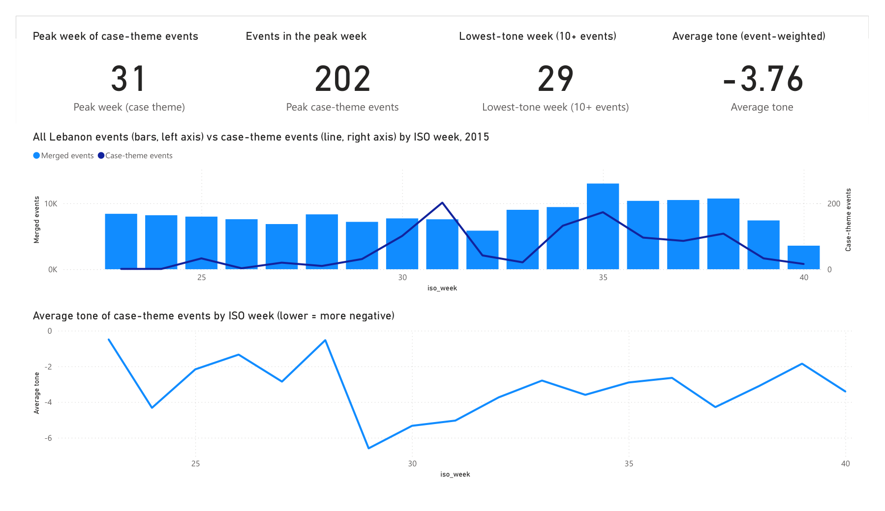
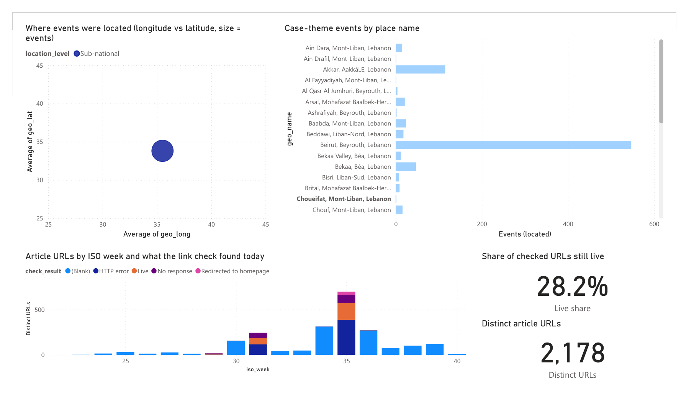
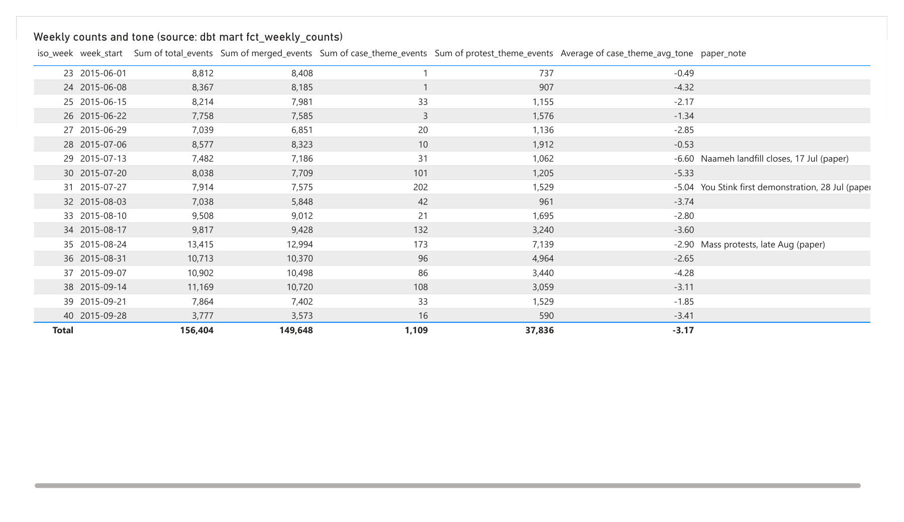

# Power BI project (.pbip)

An interactive report on the Garbage Crisis 2015 marts, for readers who prefer clicking to coding. It reads
the same three CSV files as the R and Python scripts (`data/sample/`), so it needs **no cloud account and no
credentials**.

<p>
  <a href="../docs/figures/powerbi_page1.png"></a> &nbsp;
  <a href="../docs/figures/powerbi_page2.png"></a> &nbsp;
  <a href="../docs/figures/powerbi_page3.png"></a>
</p>

*Click a page to enlarge it.* [Download the full report as a PDF](../docs/figures/bidds_gdelt.pdf)

> **Status.** Opened and checked in Power BI Desktop (version 2.159.1231.0, October 2026):
> the report loads from the sample CSVs and shows the expected values in step 4.
> The project files were also checked against Microsoft's published JSON schemas.
> If anything fails, see [Troubleshooting](#troubleshooting) and please open an
> issue with the exact message.

## What you need

- A Windows PC. Power BI Desktop is Windows-only; on macOS or Linux use the R or Python scripts instead.
- [Power BI Desktop](https://powerbi.microsoft.com/desktop/) (free), a recent version. If it says the project
  format is not supported, update it.
- This repository on your machine (clone or download ZIP).

## Step by step

**1. Enable the project format (usually already on).**
In Power BI Desktop: File > Options and settings > Options > Preview features. If you see these, tick them and
restart Power BI Desktop; if you do not see them, they are already on by default.

- Power BI Project (.pbip) save option
- Store semantic model using TMDL format
- Store reports using enhanced metadata format (PBIR)

**2. Open the project.**
Double-click `powerbi/bidds_gdelt.pbip`, or in Power BI Desktop use File > Open report > Browse this device and
select that file. If a security notice about project files appears, read it and continue.

**3. Tell the report where the repository is (one-time, 1 minute).**
The report finds its data through a single parameter called `RepoFolder`. Power BI cannot use relative paths,
so you set it once to your own folder. The repository ships with a placeholder so that no personal path is
published.

1. In Windows Explorer, open the folder that contains `README.md`. Click the address bar and copy the path,
   for example `C:\Users\you\Documents\bidds-gdelt-lebanon`.
2. In Power BI Desktop, go to Home > **Transform data** (the small arrow beside it) > **Edit parameters**.
3. Paste the path into `RepoFolder`, with no quotes and no trailing backslash. Click OK.
4. Click **Apply changes** in the yellow bar that appears. Data loads in a few seconds.

If Power BI asks about data privacy levels, choose to ignore privacy levels for this file; the data are local
CSV files.

**4. Check it worked.** Page 1, "Media attention", should show:

| Card | Expected value |
|---|---|
| Peak week of case-theme events | 31 |
| Events in the peak week | 202 |
| Lowest-tone week (10+ events) | 29 |
| Average tone (event-weighted) | -3.76 |

On page 2, "Distinct article URLs" should show 2,178. If these match, the model is loaded correctly.

**5. (Optional) Add the link-check results.**
Page 2 has a "Share of checked URLs still live" card and a stacked chart of link status. They stay empty
until you create `data/url_check.csv` by running either `Rscript r/03_check_urls.R` or
`python python/03_check_urls.py` (it contacts about 950 external websites, so allow a few minutes; see the
security notes in the main README). Then use
Home > **Refresh** in Power BI. With the committed sample you should get a live share of about 29.3%
(280 of 957 checked URL-week rows).

**6. Save your work.** File > Save writes back into this folder as text files. That is what makes the project
diff-able in git. Local caches (`.pbi/localSettings.json`, `cache.abf`) are git-ignored; your `RepoFolder`
value is stored in the model, so **do not commit it** (see below).

## The three pages

| Page | Research question it serves | Main visuals |
|---|---|---|
| Media attention | When did coverage of the waste issue peak, and how negative was it? | Four summary cards; bars (all events) against a line (case-theme events) on a second axis; weekly tone line |
| Where and sources | Where were events placed, and can the stories still be verified? | Longitude/latitude bubble chart; events by place name; link status by week; live-share card |
| Weekly data | What exactly are the numbers behind the charts? | Table of the weekly mart, with the dates the paper links to weeks 29, 31 and 35 |

The bubble chart is deliberately a plain scatter of coordinates, because Power BI's Map visual needs internet
access and tenant permissions that not everyone has. To use a real basemap: select the chart, pick the **Map**
visual in the Visualizations pane, and drag `geo_long`/`geo_lat` to Longitude/Latitude.

## How the model is built

```
RepoFolder (parameter) --> weekly      <- data/sample/fct_weekly_counts.csv
                      |--> locations   <- data/sample/fct_case_event_locations.csv
                      |--> urls        <- data/sample/fct_case_event_urls.csv
                      \--> url_check   <- data/url_check.csv (optional; empty table if missing)
relationship: urls[url] (many) --> url_check[url] (one)
```

Key measures (all in the `.tmdl` files under `bidds_gdelt.SemanticModel/definition/tables/`):

| Measure | Meaning |
|---|---|
| `Average tone` | Case-theme tone weighted by events per week, so busy weeks count for more |
| `Peak week (case theme)` | ISO week with the most case-theme events |
| `Lowest-tone week (10+ events)` | Most negative weekly tone among weeks with at least 10 events; ignores one-event weeks that are noise |
| `Live share` | Live URLs divided by URLs checked. "Live" means HTTP 200 and not a redirect to a homepage |

`weekly[week_start]` converts ISO year and week to the Monday of that week. `weekly[paper_note]` holds the
three dates the paper uses to interpret weeks 29, 31 and 35.

## Sharing this project safely

- The committed `RepoFolder` is a placeholder (`C:\path\to\bidds-gdelt-lebanon`). After you set your own path,
  Power BI saves it into `definition/expressions.tmdl`. Before committing, reset it:
  `git checkout -- powerbi/bidds_gdelt.SemanticModel/definition/expressions.tmdl`
  or skip staging that file.
- No credentials are stored in the project. If you later switch to a BigQuery source, Power BI keeps your
  Google sign-in in your Windows profile, not in these files.
- Never publish a `.pbix` of this data to a public workspace without checking that every table in it is
  something you are happy to share. The CSVs here contain only aggregated counts and public news links.

## Troubleshooting

| Symptom | Cause and fix |
|---|---|
| Visuals empty or show errors right after opening | `RepoFolder` is still the placeholder. Do step 3 |
| "DataSource.NotFound" / "could not find a part of the path" | Path typed wrongly, has quotes, or points to the wrong folder. It must be the folder that contains `data\sample` |
| Project will not open, or reports an unsupported format | Update Power BI Desktop; enable the preview features in step 1 |
| "Live share" card is blank | `data/url_check.csv` does not exist yet (step 5); this is expected |
| A visual says it cannot display | Click Home > Refresh. If it persists, tell us which visual and the message |
| Numbers differ from step 4 | You may have re-run dbt and exported fresh marts; GDELT can be reprocessed, so small differences are possible |

If the report layer fails to load but you can open the model, you can rebuild visuals by hand: the measures
above are the important part, and the CSVs are plain and easy to import with Home > Get data > Text/CSV.
